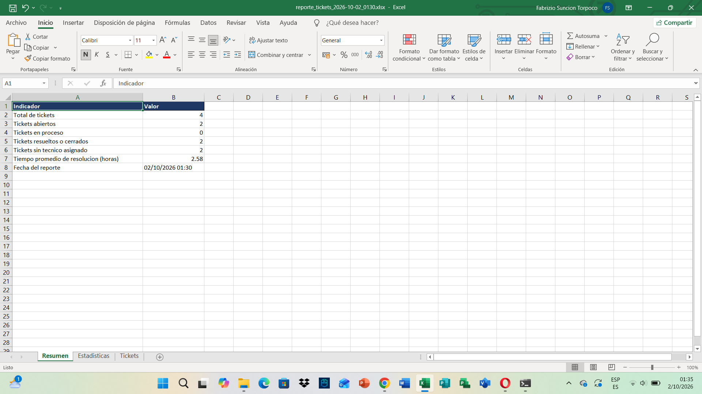
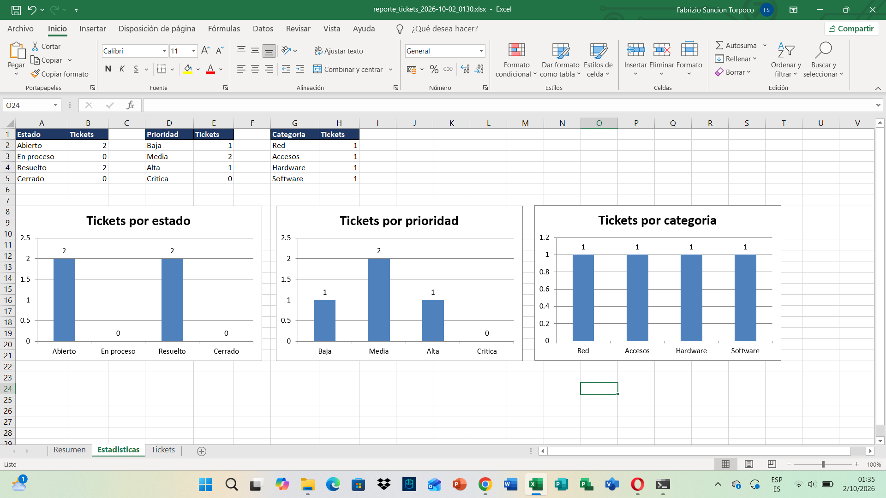

# HelpDesk Reportes - Reporte automático en Excel con Python

Script en Python que se conecta a la base de datos del proyecto [HelpDesk](https://github.com/FabrizioSuncion/helpdesk-aspnet-core) (SQL Server) y genera un reporte en Excel con estadísticas de los tickets de soporte.

## Qué genera

Un archivo `.xlsx` con la fecha en el nombre, con tres hojas:

- **Resumen:** total de tickets, abiertos, en proceso, resueltos o cerrados, sin técnico asignado y tiempo promedio de resolución en horas.

- **Estadisticas:** tablas de tickets por estado, prioridad y categoría, con un gráfico de columnas para cada una.

- **Tickets:** el detalle de todos los tickets, con filtros y encabezado fijo.

## Tecnologías

- Python 3.13

- pyodbc (conexión a SQL Server)

- pandas (cálculo de estadísticas)

- XlsxWriter (Excel con formato y gráficos)

- SQL Server (LocalDB)

## Capturas

## Cómo usarlo

Requisitos: Python 3.11 o superior, ODBC Driver 17 o 18 for SQL Server y la base de datos `HelpDeskDb` creada por el proyecto HelpDesk.

    git clone https://github.com/FabrizioSuncion/helpdesk-reportes.git

    cd helpdesk-reportes

    python -m venv .venv

    .venv\Scripts\activate

    pip install -r requirements.txt

    python reportes.py

El reporte se guarda en la carpeta `reportes/`. Por defecto se conecta a `(localdb)\MSSQLLocalDB` y a la base `HelpDeskDb`. Se pueden cambiar con opciones:

    python reportes.py --servidor "(localdb)\MSSQLLocalDB" --base HelpDeskDb --salida reportes

## Próximas mejoras

- Programar la ejecución diaria con el Programador de tareas de Windows.

- Enviar el reporte por correo.

- Filtrar por rango de fechas.

- Pruebas automáticas de los cálculos.

## Autor

Fabrizio Suncion - estudiante de Ingeniería de Sistemas Computacionales (UPN).

